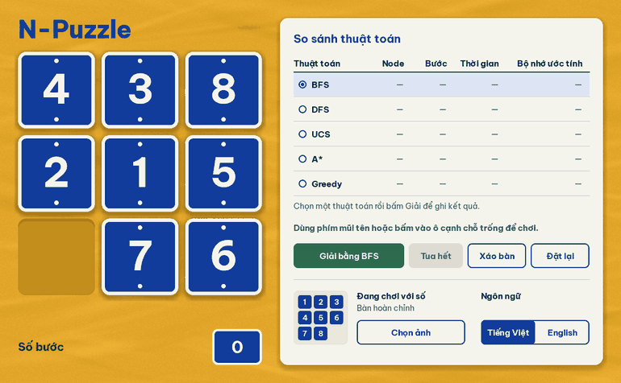

# N-Puzzle

Trò chơi xếp ô 3×3 viết bằng Python và pygame. Bạn có thể tự chơi với số hoặc ảnh của mình, hoặc để năm thuật toán tìm kiếm giải cùng một bàn rồi so sánh kết quả ngay trong app.

**Tiếng Việt** · [English](#english)



## Mục lục

- [Tính năng](#tính-năng)
- [Cài đặt và chạy](#cài-đặt-và-chạy)
- [Cách chơi](#cách-chơi)
- [So sánh thuật toán trên cùng một bàn](#so-sánh-thuật-toán-trên-cùng-một-bàn)
- [Các thuật toán](#các-thuật-toán)
- [Kết quả đo](#kết-quả-đo)
- [Cấu trúc dự án](#cấu-trúc-dự-án)
- [Phát triển](#phát-triển)
- [Thiết kế](#thiết-kế)

## Tính năng

- **Tự chơi:** dùng phím mũi tên hoặc bấm vào ô cạnh chỗ trống. Bàn xáo ngẫu nhiên luôn giải được.
- **Năm thuật toán:** BFS, DFS, UCS, A* và Greedy chạy ở luồng nền nên cửa sổ không bị đứng, và có thể hủy bất cứ lúc nào.
- **Phát lại lời giải:** xem từng bước đi, hoặc tua thẳng đến cuối khi lời giải quá dài.
- **Bảng so sánh:** số node, số bước, thời gian và bộ nhớ ước tính của từng thuật toán trên cùng một bàn. Giá trị tốt nhất được tô xanh.
- **Chơi với ảnh của bạn:** chọn tệp JPG, PNG hoặc BMP. Ảnh được cắt vuông từ giữa nên không bị méo, và hình hoàn chỉnh luôn hiện để đối chiếu.
- **Hai ngôn ngữ:** tiếng Việt và tiếng Anh, lựa chọn được ghi nhớ cho lần sau.
- **Dùng được bằng bàn phím:** Tab để chuyển giữa các nút, Enter hoặc Space để bấm.

| Chế độ ảnh | Giao diện tiếng Anh |
|---|---|
|  |  |

## Cài đặt và chạy

Cần Python 3.10 trở lên.

```bash
git clone https://github.com/Thien21112005/n-puzzle-solver.git
cd n-puzzle-solver
python -m venv .venv
.venv\Scripts\activate        # macOS/Linux: source .venv/bin/activate
pip install -e .
python -m npuzzle
```

Trên Linux, hộp thoại chọn ảnh cần thêm gói `python3-tk`. Dự án mới được chạy thử trên Windows.

Để tạo file chạy độc lập cho Windows, xem phần [Phát triển](#phát-triển).

## Cách chơi

Mục tiêu là đưa bàn về thứ tự `1 2 3 / 4 5 6 / 7 8 _`, với chỗ trống ở góc dưới bên phải.

| Thao tác | Tác dụng |
|---|---|
| Phím mũi tên | Trượt ô theo hướng mũi tên vào chỗ trống |
| Bấm vào ô cạnh chỗ trống | Trượt ô đó |
| **Xáo bàn** | Tạo bàn mới, xóa bảng kết quả |
| **Đặt lại** | Về bàn ban đầu, số bước về 0 |
| **Chọn ảnh** | Chơi với ảnh của bạn trên một bàn mới |
| Tab, rồi Enter hoặc Space | Điều khiển các nút bằng bàn phím |

## So sánh thuật toán trên cùng một bàn

1. Bấm vào một dòng trong bảng để chọn thuật toán.
2. Bấm **Giải bằng ...**. Khi đang tìm hoặc đang phát lại, nút này đổi thành **Hủy**.
3. Xem lời giải chạy từng bước, hoặc bấm **Tua hết** để đến ngay cuối.
4. Chọn thuật toán khác rồi bấm **Giải** lần nữa. App tự quay về đúng bàn đó và ghi thêm một dòng vào bảng.

Từ thuật toán thứ hai trở đi, giá trị tốt nhất ở mỗi cột được tô xanh. Nếu bạn tự đi thêm vài bước rồi mới giải thì đó là một bàn khác, nên bảng sẽ bắt đầu lại.

## Các thuật toán

Mọi thuật toán dùng chung một vòng lặp tìm kiếm và chỉ khác nhau ở cách chọn trạng thái xét tiếp theo ([`core/solvers.py`](src/npuzzle/core/solvers.py)).

| Thuật toán | Chọn trạng thái tiếp theo | Lời giải ngắn nhất? |
|---|---|---|
| BFS | Thêm vào trước thì xét trước | Có |
| DFS | Thêm vào sau thì xét trước | Không, thường rất dài |
| UCS | Chi phí đã đi `g` nhỏ nhất | Có |
| A* | `g + h` nhỏ nhất | Có |
| Greedy | Heuristic `h` nhỏ nhất | Không |

- `g` là số bước đã đi từ bàn ban đầu.
- `h` là khoảng cách Manhattan: tổng khoảng cách từ mỗi ô đến vị trí đích của nó. Mỗi nước đi chỉ dời một ô đi một bước, nên `h` không bao giờ vượt quá số bước thật, và vì thế A* cho lời giải ngắn nhất.

Vì mỗi bước đi có chi phí bằng nhau, UCS mở rộng các trạng thái theo cùng thứ tự độ sâu như BFS, nên số node của hai thuật toán này giống nhau.

Không phải bàn nào cũng giải được: chỉ một nửa trong 9! cách xếp là tới được đích. App kiểm tra tính chẵn lẻ của số nghịch thế để chỉ tạo bàn giải được ([`core/board.py`](src/npuzzle/core/board.py)).

## Kết quả đo

Trung bình trên 100 bàn ngẫu nhiên giải được, đo trên một máy Windows bằng Python 3.13. Số node và số bước phụ thuộc vào bàn chơi, còn thời gian sẽ khác đi tùy máy.

| Thuật toán | Node trung bình | Bước trung bình | Thời gian trung bình |
|---|---:|---:|---:|
| BFS | 112.884 | 22,2 | 418 ms |
| DFS | 140.360 | 42.003 | 564 ms |
| UCS | 112.884 | 22,2 | 364 ms |
| A* | 2.538 | 22,2 | 8,1 ms |
| Greedy | 440 | 41,7 | 1,3 ms |

- **A*** cho lời giải ngắn như BFS nhưng chỉ mở khoảng 2% số node.
- **Greedy** mở ít node nhất, đổi lại lời giải dài gần gấp đôi mức tối ưu.
- **DFS** cho lời giải dài hàng chục nghìn bước, phát lại ở tốc độ 200 ms/bước có thể mất vài giờ. Đó là lý do app có nút tua đến cuối.

Cột bộ nhớ trong app là ước tính (200 byte cho mỗi trạng thái), không phải số đo thực tế, nên được ghi rõ là ước tính và không đưa vào bảng này.


## Cấu trúc dự án

```
src/npuzzle/
├─ core/                 không phụ thuộc pygame
│  ├─ board.py           luật chơi, kiểm tra giải được, heuristic
│  ├─ solvers.py         vòng lặp tìm kiếm và năm thuật toán
│  └─ session.py         trạng thái ván chơi, luồng giải, phát lại
├─ ui/
│  ├─ theme.py           màu, kích thước, font
│  ├─ draw.py            bo góc mịn, bóng đổ, căn số
│  ├─ widgets.py         nút và công tắc
│  ├─ board_view.py      bàn chơi và hiệu ứng
│  ├─ image_tiles.py     cắt ảnh thành ô
│  └─ panels.py          bảng so sánh và điều khiển
├─ assets/fonts/         font Be Vietnam Pro
├─ app.py                vòng lặp game, xử lý sự kiện
├─ i18n.py               chuỗi tiếng Việt, tiếng Anh, định dạng số
├─ settings.py           lưu cài đặt
└─ paths.py              đường dẫn asset
tests/                   kiểm thử tự động
```

## Phát triển

```bash
pip install -e ".[dev]"
pytest                     # chạy toàn bộ test
ruff check src tests       # kiểm tra code
pyinstaller npuzzle.spec   # tạo dist/n-puzzle.exe
```

Test bao gồm luật chơi, độ dài tối ưu của lời giải so với BFS, luồng giải và hủy, cùng việc mọi nhãn đều vừa khung ở cả hai ngôn ngữ. Test giao diện chạy không cần màn hình.

## Thiết kế

Giao diện lấy cảm hứng từ biển số nhà tráng men xanh trên những bức tường vôi vàng ở Hà Nội. Bảng màu, kiểu chữ và các quy tắc thiết kế được ghi trong [DESIGN.md](DESIGN.md), còn mục đích sản phẩm nằm trong [PRODUCT.md](PRODUCT.md).

---

## English

A 3×3 sliding puzzle in Python and pygame. Play it yourself with numbers or your own picture, or let five search algorithms solve the same board and compare the measured results in the app. The interface is available in Vietnamese and English; switch at the bottom right of the window.

### Run it

Requires Python 3.10 or newer. It has only been run on Windows so far; on Linux the picture dialog also needs `python3-tk`.

```bash
git clone https://github.com/Thien21112005/n-puzzle-solver.git
cd n-puzzle-solver
python -m venv .venv
.venv\Scripts\activate        # macOS/Linux: source .venv/bin/activate
pip install -e .
python -m npuzzle
```

### Use it

- **Play:** use the arrow keys or click a tile next to the gap.
- **Compare:** click an algorithm row, press **Solve**, then pick another row and press **Solve** again. The app returns to the same board and adds a row to the table.
- **Long solutions:** press **Skip** to jump to the end. DFS solutions often run to tens of thousands of moves.
- **Keyboard:** Tab moves between controls, and Enter or Space activates them.

### Measured results

Averages over 100 random solvable boards, on one Windows machine with Python 3.13. Times vary by machine.

| Algorithm | Avg. nodes | Avg. moves | Avg. time | Shortest solution? |
|---|---:|---:|---:|---|
| BFS | 112,884 | 22.2 | 418 ms | Yes |
| DFS | 140,360 | 42,003 | 564 ms | No |
| UCS | 112,884 | 22.2 | 364 ms | Yes |
| A* (Manhattan) | 2,538 | 22.2 | 8.1 ms | Yes |
| Greedy (Manhattan) | 440 | 41.7 | 1.3 ms | No |

The memory column in the app is an estimate of 200 bytes per state, not a measurement, so it is left out here.

### Develop

```bash
pip install -e ".[dev]"
pytest
ruff check src tests
pyinstaller npuzzle.spec   # builds dist/n-puzzle.exe
```

## License

Mã nguồn của dự án chưa khai báo giấy phép. Font Be Vietnam Pro đi kèm dùng giấy phép SIL Open Font License ([OFL.txt](src/npuzzle/assets/fonts/OFL.txt)).

The project's own code has no license declared yet. The bundled Be Vietnam Pro font is under the SIL Open Font License.
