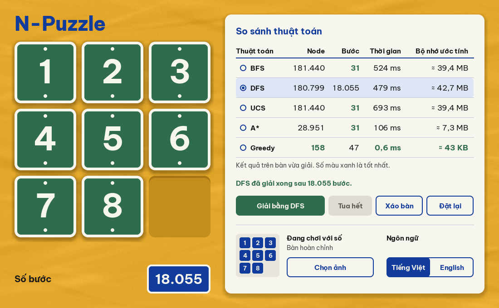
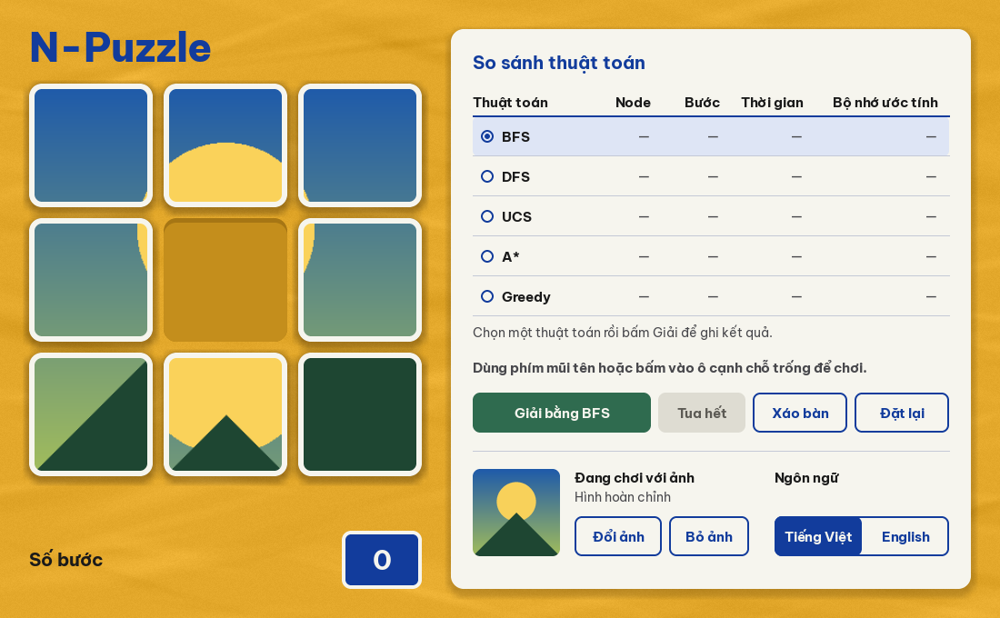
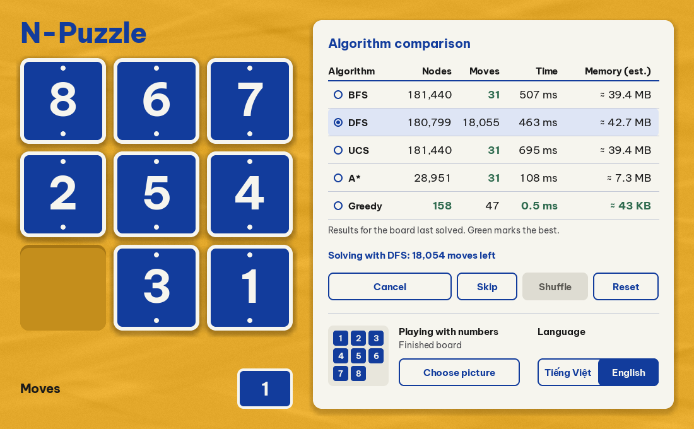

# N-Puzzle

Trò chơi xếp ô 3×3 viết bằng Python và pygame. Bạn có thể tự chơi với số hoặc ảnh của mình, hoặc để BFS, DFS, UCS, A* và Greedy giải rồi so sánh kết quả ngay trên cùng một bàn.

*[English below](#english)*



| Tự chơi với ảnh | Giao diện tiếng Anh |
|---|---|
|  |  |

## Tính năng

- Chơi bằng phím mũi tên hoặc bấm vào ô cạnh chỗ trống. Bàn xáo ngẫu nhiên luôn giải được.
- Năm thuật toán chạy ở luồng nền, có thể hủy. Lời giải được phát lại từng bước, có nút tua đến cuối.
- Bảng so sánh số node, số bước, thời gian và bộ nhớ ước tính trên bàn vừa giải.
- Chơi với ảnh của bạn: ảnh được cắt vuông từ giữa, không bị méo.
- Giao diện tiếng Việt và tiếng Anh, lựa chọn được ghi nhớ.

## Kết quả mẫu

Đo trên bàn `8 6 7 / 2 5 4 / 3 _ 1`, một trong các bàn khó nhất (31 bước). Thời gian thay đổi theo máy.

| Thuật toán | Node | Bước | Thời gian |
|---|---:|---:|---:|
| BFS | 181.440 | 31 | 531 ms |
| DFS | 180.799 | 18.055 | 491 ms |
| UCS | 181.440 | 31 | 723 ms |
| A* | 28.951 | 31 | 105 ms |
| Greedy | 158 | 47 | 0,5 ms |

BFS, UCS và A* cho lời giải ngắn nhất. A* mở ít node hơn BFS khoảng 6 lần. Greedy rất nhanh nhưng lời giải dài hơn. Lời giải DFS dài hàng chục nghìn bước, nên app có nút tua đến cuối.

## Chạy từ mã nguồn

Cần Python 3.10 trở lên.

```bash
python -m venv .venv
.venv\Scripts\activate
pip install -e .
python -m npuzzle
```

## Phát triển

```bash
pip install -e ".[dev]"
pytest
ruff check src tests
pyinstaller npuzzle.spec   # tạo dist/n-puzzle.exe
```

```
src/npuzzle/
├─ core/      luật chơi, thuật toán, trạng thái ván chơi (không phụ thuộc pygame)
├─ ui/        giao diện pygame
├─ assets/    font đi kèm
├─ app.py     vòng lặp game và xử lý sự kiện
├─ i18n.py    chuỗi tiếng Việt và tiếng Anh
└─ settings.py
tests/        kiểm thử tự động
```

## English

A 3×3 sliding puzzle in Python and pygame. Play it yourself with numbers or your own picture, or let BFS, DFS, UCS, A* and Greedy solve the same board and compare the measured results side by side. The interface is available in Vietnamese and English.

Run it with Python 3.10 or newer:

```bash
python -m venv .venv
.venv\Scripts\activate
pip install -e .
python -m npuzzle
```

## License

The bundled Be Vietnam Pro font is distributed under the SIL Open Font License ([OFL.txt](src/npuzzle/assets/fonts/OFL.txt)). The project's own code has no license declared yet.
